# 🚀 Awesome CRM Customization & Extensibility

  <strong>Curated Directory of Enterprise SaaS Solutions, Low-Code iPaaS &amp; Open-Source CRM Extensibility Frameworks</strong>

  
  
  
  
  

  <a href="#-sector-overview--market-dynamics">Sector Overview</a> •
  <a href="#-saashosted-platforms">SaaS Marketplaces &amp; iPaaS</a> •
  <a href="#-open-source-github-projects">Open-Source Frameworks</a> •
  <a href="#-how-to-contribute">Contributing</a> •
  <a href="#-support--sponsorship">Support</a> •
  <a href="#-star-history">Star History</a>

---

## 📌 Executive Summary

Modern enterprise CRM systems cannot remain isolated databases. Teams require deep **platform extensibility**, **programmable webhooks**, **custom-coded actions**, **low-code workflow builders**, and **event-driven orchestration** to mold off-the-shelf software to proprietary business models.

This community repository documents the premier ecosystem for **CRM Customization & Extensibility**:
- 🏢 **Enterprise SaaS Ecosystems & Marketplaces**: Multi-cloud platforms, app exchange directories, and managed iPaaS automation networks.
- 🔓 **Self-Hosted & Open-Source Infrastructure**: Self-hostable workflow automation engines, internal low-code builders, data synchronization protocols, and programmable notification networks for data sovereignty and zero-task-tax deployments.

---

## 📑 Table of Contents
- [📊 Sector Overview & Market Dynamics](#-sector-overview--market-dynamics)
- [☁️ SaaS/Hosted Platforms](#-saashosted-platforms)
- [🔓 Open-Source GitHub Projects](#-open-source-github-projects)
- [💡 Architectural Guidance & Best Practices](#-architectural-guidance--best-practices)
- [🤝 How to Contribute](#-how-to-contribute)
- [⭐ Star History](#-star-history)
- [💖 Support & Sponsorship](#-support--sponsorship)
- [⚖️ Disclaimer](#️-disclaimer)

---

## 📊 Sector Overview & Market Dynamics

The global CRM and workflow integration ecosystem is valued at over **$85B–$120B+** (with enterprise CRM reaching ~$85B–$126B and the expanding iPaaS/automation layer contributing an additional $12B+ at a ~12% CAGR). The market exhibits a distinct two-tiered structure: the core CRM and enterprise integration tier is **moderately concentrated** dominated by multi-billion dollar platform giants (Microsoft, Salesforce, HubSpot), while the middle-layer workflow automation and low-code extensibility space remains **highly fragmented** with hundreds of visual builders, API connectors, and specialized SaaS contenders competing before rapid consolidation.

---

## ☁️ SaaS/Hosted Platforms

| Product | 🏢 Company Size / Valuation / Revenue | 📝 Description | 💵 Pricing (Starting) | 🎁 Free Tier / Trial Limits |
|:---|:---|:---|:---|:---|
| **[Microsoft Power Platform](https://powerplatform.microsoft.com/)** | **~$3.9T Market Cap** / ~$346B ARR | Low-code platform for building apps, automating workflows, and analyzing data. Features Power Apps and Power Automate cloud/desktop flows. | **$15/user/month** (Power Automate Premium) or **$10/user/app/month** (Power Apps Pay-as-you-go) | **Free Developer Plan**: 1 managed developer environment, 750 cloud flow runs/month, 2 GB Dataverse database capacity (non-production); 30-day free trial for full Power Automate Premium |
| **[Salesforce AppExchange](https://appexchange.salesforce.com/)** | **~$180B Market Cap** / ~$43.9B ARR | Enterprise cloud marketplace with **7,000+ apps** and certified consulting partners extending Customer 360 with pre-built solutions. | **$25/user/month** (Salesforce Starter Suite base platform) / ISV partner listing: **$150/year** listing fee + 15% PNR | **30-day free trial** with full feature access and sample data (no credit card required); free to browse and install 1,000+ free apps |
| **[Make](https://www.make.com/)** *(by Celonis)* | **~$13B Valuation** (Celonis) / ~$700M+ ARR | Visual automation platform with operations/credits as the billing unit. Unlimited users on all plans, real-time execution monitoring, and full-text log search. | **$9/month** (Core plan, billed annually; 10,000 credits/month, 1-min intervals) | **Free forever plan**: 1,000 credits/month, 2 active scenarios, 15-minute minimum scheduling interval, 1 MB–5 MB file transfer limit |
| **[Zoho Marketplace](https://marketplace.zoho.com/)** | **~$12.5B Valuation** / ~$1.5B ARR | 2,500+ extensions and integrations extending Zoho CRM with custom modules, tab settings, and third-party app connections. | **$14/user/month** (Zoho CRM Standard, billed annually) | **Free forever plan**: up to 3 users, 5,000 records, 1 GB organization file storage, standard reports (no custom modules) |
| **[HubSpot Operations Hub](https://www.hubspot.com/products/operations)** | **~$9.8B Market Cap** / ~$3.4B ARR | Operations toolkit for bidirectional data syncing, automated cleanup, and custom JavaScript/Python code actions within workflows. | **$20/seat/month** (Operations Hub Starter) / **$720/month** (Professional with programmable custom-coded actions) | **Free forever plan**: up to 2 users, default 2-way data sync, default field mappings, up to 10 custom properties, basic form automation (no programmable code) |
| **[Workato](https://www.workato.com/)** | **~$5.7B Valuation** / ~$190M+ ARR | Enterprise iPaaS with Connector SDK for building custom connectors, importing OpenAPI specs, and orchestrating complex cross-app business workflows. | **$75/month** (Pro self-service plan, 2,500 credits/month) | **Free tier**: 50,000 one-time starter credits (never expire); 14-day free trial with enterprise connector access |
| **[Zapier](https://zapier.com/)** | **~$5.0B Valuation** / ~$310M+ ARR | No-code workflow automation connecting **9,000+ apps**. Multi-step zaps, webhooks, filters, tables, and AI orchestration. | **$19.99/month** (Professional plan, billed annually; 750 tasks/month) | **Free forever plan**: 100 tasks/month, unlimited 2-step Zaps (1 trigger + 1 action), 15-minute update/polling interval |
| **[Pipedrive Marketplace](https://www.pipedrive.com/en/marketplace)** | **~$1.5B Valuation** / ~$200M ARR | App marketplace extending Pipedrive CRM with native integrations, visual pipeline extensions, and communication tooling. | **$14/seat/month** (Lite plan, billed annually) | **14-day free trial** with unrestricted feature access and no credit card required (no permanent free tier; entry plan caps at 2,500 active leads/deals) |
| **[Tray.ai](https://tray.ai/)** | **~$600M Valuation** / ~$70M ARR | Enterprise low-code iPaaS and agent orchestration platform with 700+ connectors, OpenAPI developer SDK, and Model Context Protocol (MCP) gateway. | **$50/month** (Builder edition base) / **$500/month** (Standard workflow package) | **30-day free trial** with bundled starter task credits and assisted onboarding (no permanent free tier) |
| **[Integrately](https://integrately.com/)** | **Bootstrapped** / ~$4.5M ARR | Integration platform offering 20M+ 1-click ready automations across 1,500+ apps, visual drag-and-drop builder, and multi-step branching. | **$19.99/month** (Starter plan, billed annually; 2,000 tasks/month) | **Free forever plan**: 100 tasks/month, 5 active 1-step automations, 15-minute check interval; plus **14-day full free trial** on signup |

---

## 🔓 Open-Source GitHub Projects

These self-hostable projects empower teams to build custom CRM tooling, execute bidirectional data pipelines, automate events, and build low-code interfaces without vendor lock-in or recurring per-task costs.

*Repositories are sorted in descending order by GitHub_Stars ⭐.*

| Project | ⭐ Stars_Badge | 🛠️ Tech Stack / License | 📝 Description & Extensibility Features |
|:---|:---|:---|:---|
| **[n8n](https://github.com/n8n-io/n8n)** |  | TypeScript / Fair-Code (Sustainable Use) | **Premier workflow automation platform.** Visual node editor with 400+ native integrations, custom JS/Python code execution nodes, AI agent tool nodes, and self-hosted Docker deployment. |
| **[NocoDB](https://github.com/nocodb/nocodb)** |  | Node.js, Vue / AGPLv3 | **Open-source Airtable alternative.** Transforms any relational database (PostgreSQL, MySQL, SQL Server) into a collaborative smart spreadsheet with REST APIs, webhook triggers, and CRM interfaces. |
| **[Twenty](https://github.com/twentyhq/twenty)** |  | TypeScript, React, NestJS / AGPLv3 | **Modern open-source CRM alternative to Salesforce.** Built from the ground up for developers with extensible GraphQL/REST APIs, custom object modeling, and self-hosted cloud sync. |
| **[Huginn](https://github.com/huginn/huginn)** |  | Ruby / MIT | **Self-hosted event monitoring system.** Create automated agents that watch for online events, scrape CRM status pages, propagate webhooks, and perform automated actions across the web. |
| **[Appsmith](https://github.com/appsmithorg/appsmith)** |  | TypeScript, Java / Apache 2.0 | **Low-code framework for custom internal apps & CRM portals.** Connects directly to PostgreSQL, REST APIs, and CRM databases to construct rich visual dashboards and administrative actions. |
| **[ToolJet](https://github.com/ToolJet/ToolJet)** |  | JavaScript, TypeScript / AGPLv3 | **Extensible open-source low-code platform.** Enables developers to build custom internal CRM tools, executive dashboards, and customer operations portals with drag-and-drop UI components. |
| **[Novu](https://github.com/novuhq/novu)** |  | TypeScript, NestJS, React / Apache 2.0 | **Open-source notification infrastructure.** Connect CRM workflows to multi-channel communication pipelines (email, SMS, push, in-app feed, chat/Slack) with centralized digest engines. |
| **[Refine](https://github.com/refinedev/refine)** |  | React, TypeScript / MIT | **React-based framework for rapid internal tools and CRM frontends.** Offers deep decoupled data connectors, authentication providers, and state management for custom CRM applications. |
| **[Budibase](https://github.com/Budibase/budibase)** |  | TypeScript, Svelte / GPLv3 | **All-in-one low-code platform for operational apps.** Build business dashboards, customer tracking tables, approval workflows, and role-based forms directly on top of your existing CRM databases. |
| **[Activepieces](https://github.com/activepieces/activepieces)** |  | TypeScript, Node.js / MIT | **Open-source no-code workflow automation.** Modern MIT-licensed alternative to Zapier/Make featuring visual drag-and-drop builders, piece-based modular connectors, and AI agent execution. |
| **[Node-RED](https://github.com/node-red/node-red)** |  | JavaScript, Node.js / Apache 2.0 | **Flow-based visual programming tool.** Connects hardware devices, REST APIs, and enterprise cloud applications. Ideal for lightweight event-driven CRM messaging and webhook routing. |
| **[Airbyte](https://github.com/airbytehq/airbyte)** |  | Java, Python / ELv2 | **Leading open-source data integration engine (ELT).** Syncs customer contacts, deal stages, and product usage data from 300+ sources into data warehouses and CRM destinations. |
| **[Windmill](https://github.com/windmill-labs/windmill)** |  | Rust, TypeScript, Python / AGPLv3 | **Developer-centric workflow and internal tool platform.** High-performance alternative to Retool and Temporal. Write endpoints and workflows in Python/TS/Go with auto-generated UIs. |
| **[Automatisch](https://github.com/automatisch/automatisch)** |  | JavaScript, React / AGPLv3 | **Self-hosted business automation platform.** Straightforward Zapier alternative for privacy-conscious teams needing GDPR compliance and direct control over internal CRM data pipelines. |

---

## 💡 Architectural Guidance & Best Practices

When architecting a customizable and extensible CRM ecosystem:
1. **Decouple Core Data from Custom Business Logic**: Avoid building intricate business routines directly inside legacy CRM database procedures. Utilize middleware (such as **n8n**, **Windmill**, or **Zapier**) to orchestrate external microservices.
2. **Audit OAuth Scopes & Permissions**: Third-party plugins and marketplace extensions often request excessive data access. Audit app tokens regularly and ensure least-privilege principles are enforced.
3. **Budget for SaaS Task Scaling vs. Self-Hosting Overhead**: Visual SaaS iPaaS platforms offer instantaneous speed-to-market but carry unpredictable usage-based cost escalations. Open-source solutions like **Twenty**, **Activepieces**, and **Node-RED** provide zero per-task billing at the cost of infrastructure maintenance.

---

## 🤝 How to Contribute

Contributions are welcome and highly encouraged! To contribute:

1. 🍴 **Fork the Repository** on GitHub.
2. 🌿 **Create a Feature Branch** (`git checkout -b feature/add-new-tool`).
3. 📝 **Add or Update Entries**:
   - Maintain alphabetical or star-sorted ordering where applicable.
   - For SaaS products, provide verifiable starting pricing and precise free tier limits.
   - For open-source projects, include the official repository link, stargazers badge link, tech stack, and license.
4. 🚀 **Commit & Push** (`git commit -m "Add tool name to open-source directory"`).
5. 📬 **Open a Pull Request** with a concise description of why the tool benefits the community.

Please explore the [Awesome Collection](https://github.com/ishandutta2007/Awesome-Awesome-Awesome) for more curated software lists!

---

## 💖 Support & Sponsorship

If you found this curated list helpful for your architecture, business workflows, or technical research, please consider supporting the project:

- ⭐ **Star this repository** to help others discover it!
- 🍴 **Fork and share** with fellow developers and CRM architects.
- ☕ **Sponsor the Maintainer**: Buy a coffee or support ongoing open-source maintenance via the [GitHub Sponsor Dashboard](https://github.com/sponsors/ishandutta2007).

Your support keeps this guide independently maintained, accurate, and continually updated!

---

## ⭐ Star History

---

## ⚖️ Disclaimer

- This is an independent, **community-curated directory**; inclusion does not imply official endorsement or sponsorship by any listed company.
- Pricing metrics, limits, and software feature sets are subject to ongoing vendor revisions. Verify terms directly on the official product websites before making commercial procurement commitments.
